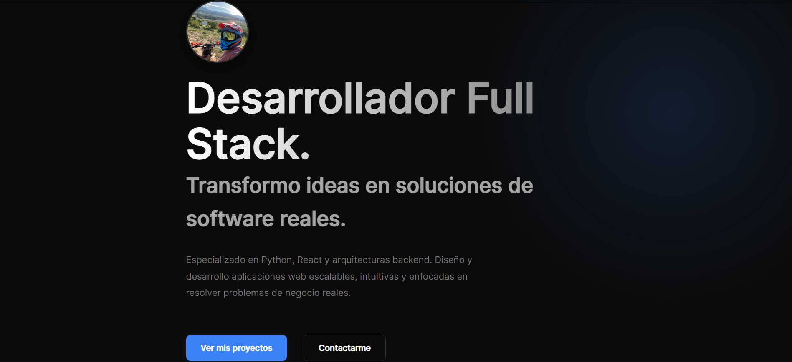

<div align="center">
  <a href="https://rodria45.github.io/rodrigo-antunez-portfolio/" target="_blank">
    
  </a>

  <br /><br />

  <a href="https://github.com/RodriA45/rodrigo-antunez-portfolio/actions/workflows/deploy.yml">
    
  </a>
  <a href="https://rodria45.github.io/rodrigo-antunez-portfolio/">
    
  </a>
  
  
  
</div>

---

## Preview

<div align="center">
  <a href="https://rodria45.github.io/rodrigo-antunez-portfolio/" target="_blank">
    
  </a>
</div>

---

## Arquitectura y flujo de despliegue

<div align="center">
  
</div>

---

## Aspectos clave

| Área | Implementación |
| :--- | :--- |
| **Catálogo dinámico** | Esquema tipado en [`src/data/projects.ts`](src/data/projects.ts) con filtros (*Destacados*, *Todos*, *Frontend*, *Backend*, *Full Stack*, *Data & Scripts*), carruseles multi-imagen y visor *Lightbox*. |
| **Bilingüe (ES / EN)** | Cambio instantáneo de idioma con `i18next` y `react-i18next` usando diccionarios en `src/locales/` y traducciones por proyecto. |
| **Temas y UI adaptable** | Selector de 4 paletas de acento (`ThemeSwitcher`), animaciones con `framer-motion` y diseño responsive para desktop, móvil, horizontal y pantallas duales (`horizontal-viewport-segments`). |
| **Secciones** | `Hero`, `AboutMe`, `Services`, `Skills`, `ProjectGrid`, `CapstoneProject` (**UniGames**) y `ContactCTA`. |
| **CI/CD** | Pipeline en [`.github/workflows/deploy.yml`](.github/workflows/deploy.yml) con jobs separados de `build` y `deploy` hacia GitHub Pages. |

---

<details>
<summary><strong>Ejecución local y scripts disponibles</strong></summary>

### Requisitos
- Node.js 20 o superior

### Instalación y desarrollo
```bash
git clone https://github.com/RodriA45/rodrigo-antunez-portfolio.git
cd rodrigo-antunez-portfolio
npm install
npm run dev
```

En Windows podés ejecutar `start.bat` para instalar dependencias (si faltan) e iniciar el servidor local automáticamente.

### Scripts (`package.json`)
| Comando | Descripción |
| :--- | :--- |
| `npm run dev` | Levanta el servidor de desarrollo con Vite |
| `npm run build` | Verifica tipos (`tsc -b`) y genera el bundle optimizado en `dist/` |
| `npm run lint` | Ejecuta el linter (`oxlint`) |
| `npm run preview` | Sirve localmente el build de producción |

</details>

<details>
<summary><strong>Estructura de carpetas</strong></summary>

```text
.
├── .github/
│   ├── assets/             # SVGs animados usados en este README
│   └── workflows/
│       └── deploy.yml      # Build y despliegue automático a GitHub Pages
├── public/                 # Favicon, robots.txt, sitemap.xml y preview
├── src/
│   ├── assets/images/      # Capturas de proyectos optimizadas en .webp
│   ├── components/         # Navbar, Hero, AboutMe, Services, Skills, ProjectGrid, ProjectCard, CapstoneProject, ContactCTA, ThemeSwitcher
│   ├── data/
│   │   └── projects.ts     # Listado tipado y bilingüe de proyectos
│   ├── locales/            # Diccionarios de traducción (es.json, en.json)
│   ├── App.tsx             # Orquestación principal de secciones
│   ├── i18n.ts             # Configuración de i18next
│   ├── index.css           # Design tokens y temas de color
│   └── main.tsx            # Punto de entrada
├── package.json
├── start.bat
└── vite.config.ts
```

</details>
